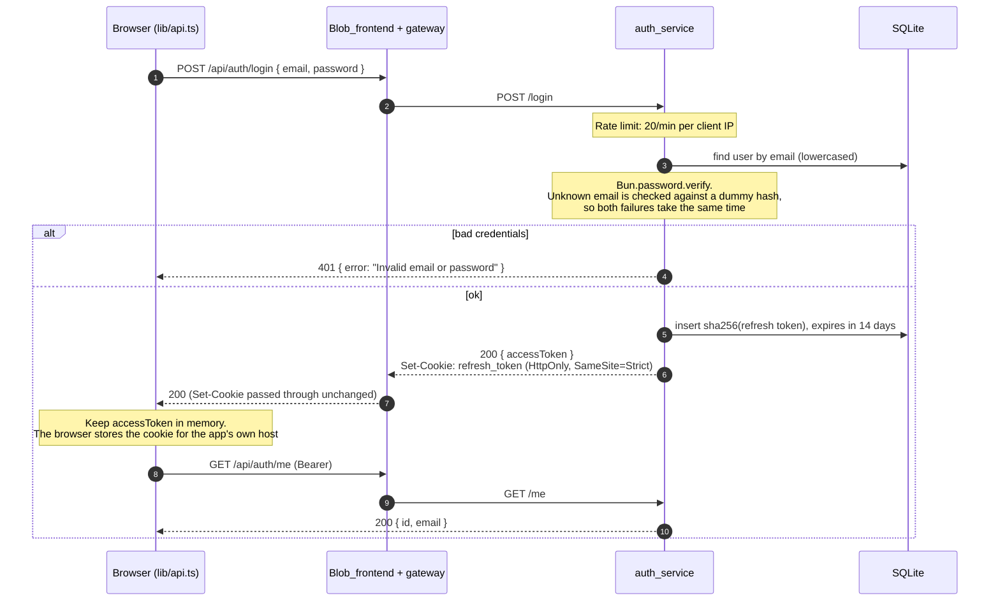
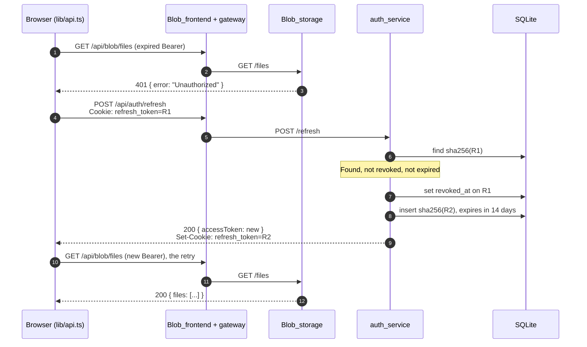
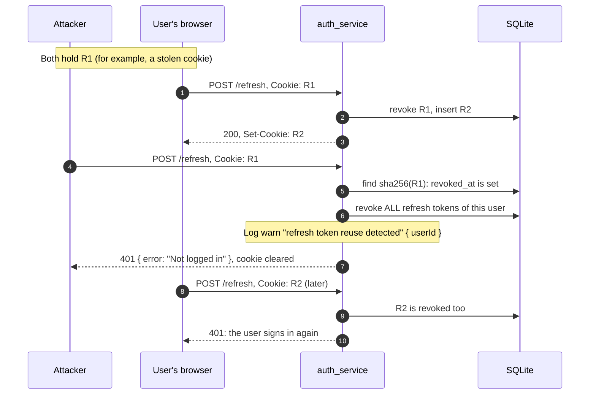
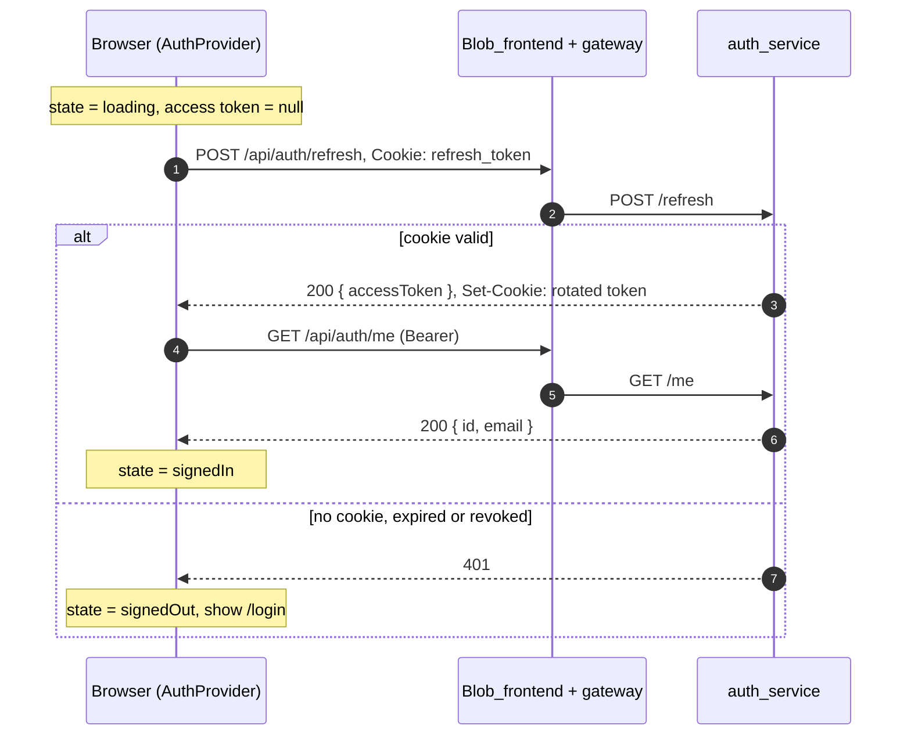

# Authentication

auth_service issues two tokens. Blob_storage checks the access token itself, so auth_service isn't on the path of every request. This page shows the four flows that matter: login, refresh with rotation, reuse revocation and page reload.

For why it works this way, see [ADR 0004](../decisions/0004-jwt-with-rotating-refresh-tokens.md). For endpoint details, see the [Auth API reference](../api/auth.md).

## The two tokens

| | Access token | Refresh token |
| --- | --- | --- |
| What it is | JWT signed with Ed25519 (`alg: EdDSA`) | 32 random bytes, base64url |
| Lifetime | 15 minutes | 14 days, replaced on every refresh |
| Stored by the client | Only in memory, in a closure in Blob_frontend's `lib/api.ts` | `refresh_token` cookie: `HttpOnly`, `SameSite=Strict`, `Path=/`, `Secure` unless `COOKIE_SECURE=false` |
| Stored by auth_service | Nothing | SHA-256 hash in the `refresh_tokens` table (SQLite), with expiry and `revoked_at` |
| Sent as | `Authorization: Bearer <token>` | The cookie, sent by the browser automatically |
| Checked by | Every service, locally, against the public key | auth_service only |

Access token claims: `sub` (user id), `iss` (`AUTH_ISSUER`), `aud` (`AUTH_AUDIENCE`, a list: `blob_storage,todos_service` by default), `iat`, `exp`.

JavaScript can't read the refresh cookie, and the access token is never written to `localStorage`, so a script injected into the page can't steal a long-lived credential.

## Login



Signing up is `POST /api/auth/register` followed by the same login. The app does both in one step.

## How Blob_storage checks an access token

Blob_storage never calls auth_service per request. It uses `jose`'s `createRemoteJWKSet`, which fetches the public keys once and caches them:

| Check | Value | Set by |
| --- | --- | --- |
| Where the keys come from | `$AUTH_ISSUER/.well-known/jwks.json` | `AUTH_JWKS_URL` (compose: `http://auth:4000/.well-known/jwks.json`) |
| Algorithm | `EdDSA` only | Code |
| `iss` | `http://localhost:4000` | `AUTH_ISSUER` |
| `aud` | must include `blob_storage` | `AUTH_AUDIENCE` |
| `exp` | not in the past | Token |
| `sub` | present; becomes the file owner | Token |

In Docker, tokens name `http://localhost:4000` as issuer because that's where you log in, but Blob_storage fetches the keys from `http://auth:4000` over the shared network. That's why `AUTH_ISSUER` and `AUTH_JWKS_URL` are separate.

A failed check returns `401 { error: "Unauthorized" }`. The reason (`missing`, `malformed`, `expired`, `invalid signature`, `wrong audience`, `invalid claims` or `key fetch failed`) only goes to the log, as `auth failed`.

## Refresh with rotation

When an access token expires, the next call gets `401`. The client swaps the refresh cookie for a new access token and retries once. Each refresh also replaces the refresh token.



If the refresh fails, the client drops its access token and the app sends the user to `/login`.

### Concurrent refreshes share one request

The files page can fire several calls at once, and they can all get `401` together. If each one called `/refresh` with the same cookie, the first would rotate it and the others would replay a now-revoked token, which logs the user out everywhere (next section).

So `lib/api.ts` keeps one in-flight refresh promise. Every caller that needs a refresh while one is running waits for the same promise:

```ts
refreshing ??= (async () => { /* POST /api/auth/refresh */ })();
return refreshing;
```

## Reuse revocation

A refresh token that has already been rotated out should never be seen again. If it is, someone probably copied it. auth_service then revokes every session of that user.



Notes:

- It works whichever side refreshes first. Either way the second use of `R1` revokes everything.
- Access tokens already issued stay valid until they expire (at most 15 minutes). They aren't tracked server side.
- Logout also sets `revoked_at`. Replaying a logged-out cookie counts as reuse too.
- The **Refresh token reuse** panel on the Grafana dashboard should stay at 0. If it doesn't, follow the [Refresh token reuse](../runbooks/refresh-token-reuse.md) runbook.

Other refresh failures don't revoke anything. They return `401` and clear the cookie, and are logged as `refresh rejected` with `reason` `no_cookie`, `unknown_token` or `expired`.

## Page reload

A reload wipes the in-memory access token, but the cookie survives. Before showing anything, `AuthProvider` (`app/providers.tsx`) tries to swap the cookie for a token.



Because the reload path also goes through the shared refresh promise, it is safe if something else triggers a refresh at the same moment.

## Logout

`POST /api/auth/logout` revokes the current refresh token, clears the cookie and returns `204`. The client drops its access token. Other sessions of the same user (other browsers) stay signed in.

## Signing key

| | |
| --- | --- |
| Private key | `AUTH_PRIVATE_KEY` in auth_service's `.env`, a JSON private JWK with a `kid`. Generate it with `bun run gen-key >> .env`. |
| Public key | `GET /.well-known/jwks.json` on auth_service, cached by clients (`Cache-Control: public, max-age=300`). |
| Rotation | Only one key at a time today. See [Rotate the JWT key](../runbooks/rotate-jwt-key.md). |
