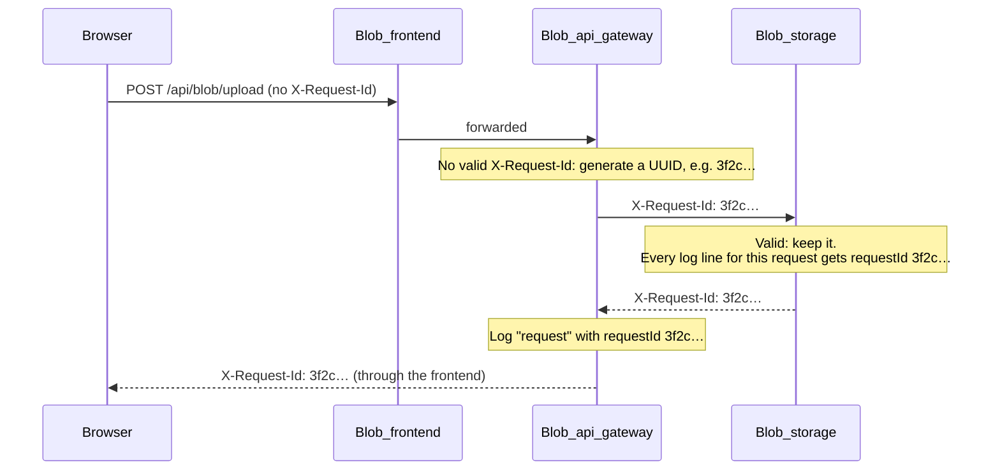
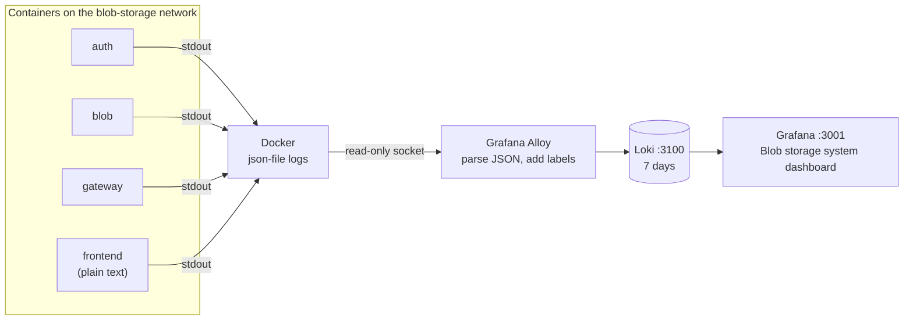

# Logging and request ids

auth_service, Blob_storage and Blob_api_gateway share one log format: one JSON object per line on stdout. Each request gets one id that every service puts on its log lines and returns in the `X-Request-Id` header. So you can follow one request across all hops with a single filter.

Why JSON on stdout and request ids: see [ADR 0006](../decisions/0006-json-logs-and-request-ids.md). How to look at the logs: see [Observability](../operations/observability.md).

## The log contract

```json
{"time":"2026-10-30T12:00:00.000Z","level":"info","service":"api_gateway","message":"request","requestId":"3f2c…","method":"POST","path":"/api/blob/upload","status":200,"ms":41,"upstream":"blob","clientIp":"172.18.0.5"}
```

Every line has these four fields:

| Field | Value |
| --- | --- |
| `time` | ISO 8601 in UTC, e.g. `2026-10-30T12:00:00.000Z` |
| `level` | `debug`, `info`, `warn` or `error` |
| `service` | `api_gateway`, `auth` or `blob` |
| `message` | A short fixed string, such as `request` or `login failed`. Filter on it; don't parse it. |

Lines written while handling a request also have `requestId`. Everything else is extra fields for that message. All three services have the same small `createLogger()` in `src/log.ts`.

### One access line per request

Each service writes exactly one `request` line per request, at `info`:

| Service | Fields |
| --- | --- |
| `api_gateway` | `requestId`, `method`, `path` (pathname only), `status`, `ms`, `upstream` (`auth` or `blob`; absent for `/health` and 404s), `clientIp` |
| `auth` | `requestId`, `method`, `route` (the pattern, `unmatched` for 404s), `status`, `ms`, `userId` when authenticated |
| `blob` | `requestId`, `method`, `route` (the pattern, e.g. `/download/:id`; `*` for the fallback page), `status`, `ms`, `userId` when authenticated |

So one upload through the gateway writes two `request` lines with the same `requestId`: the gateway's and Blob_storage's.

The other messages (`login failed`, `refresh token reuse detected`, `upload rejected`, `storage request failed`, …) are listed in each repo's README:

- [auth_service logging](https://github.com/rades12340/auth_service#logging)
- [Blob_storage logging](https://github.com/rades12340/Blob_storage#logging)
- [Blob_api_gateway logging](https://github.com/rades12340/Blob_api_gateway#logging)

### Levels and `LOG_LEVEL`

Each service reads `LOG_LEVEL` (`debug`, `info`, `warn` or `error`). Lines below that level are dropped. Unset or unknown values mean `info`. All compose files set `LOG_LEVEL: info`.

| Level | Used for |
| --- | --- |
| `debug` | Routine, high-volume events: `token refreshed`, `files listed` |
| `info` | Access lines and normal events: `request`, `login succeeded`, `file uploaded` |
| `warn` | Something was refused: `login failed`, `auth failed`, `rate limited`, `upload rejected`, `refresh token reuse detected` |
| `error` | Something is broken: `upstream request failed`, `storage request failed`, `public key fetch failed`, `unhandled error` |

## Request ids



The rules are the same in all three services:

- **Valid incoming id:** it matches `^[A-Za-z0-9._-]{1,128}$`. The service keeps it.
- **Missing or invalid:** the service generates a new UUID. This stops a client from writing arbitrary text, such as fake JSON or newlines, into the logs.
- **Echoed on every response,** including `404`, `429`, `502`, `500` and `OPTIONS` preflights.
- **Forwarded upstream** by the gateway, so auth_service and Blob_storage use the gateway's id.

Blob_frontend doesn't set an id, so in normal use the gateway assigns it. You can send your own when testing:

```bash
curl -si -H 'X-Request-Id: my-test-1' localhost:8080/api/blob/files | grep -i x-request-id
```

When a user reports a problem, ask for the `X-Request-Id` from the response (browser DevTools → Network → the request → Response headers).

## What is never logged

These stay out of the logs in every service:

- passwords
- access tokens, refresh tokens and the `Authorization` header
- cookies
- private keys and S3 credentials
- query strings: the gateway logs only the pathname, and the services log the route pattern, never the URL
- presigned download URLs, because their signature is a credential (Blob_storage logs only `download link issued`)

auth_service masks emails as `u***@example.com`, so failed logins for one address can still be grouped. Each repo has tests that fail if a secret appears in the output.

When you add a log line, pass only ids, counts, statuses and reasons as fields. Never pass a request object, headers or a URL.

## Collecting the logs

In Docker, every service's compose file uses the `json-file` log driver, rotated at 10 MB × 3 files. Blob_observability reads those container logs:



| Step | What happens |
| --- | --- |
| Discover | Alloy lists containers through the read-only Docker socket. It keeps only the compose projects `auth-service`, `blob-service`, `api-gateway` and `blob-frontend`. |
| Label | `project` (the compose project) and `container` (the compose service: `auth`, `blob`, `gateway`, `frontend`). |
| Parse | For JSON lines: `level` becomes a label, `requestId` becomes structured metadata (not a label, to keep Loki fast), and the line's own `time` becomes its timestamp. Non-JSON lines pass through unchanged. |
| Store | Loki, single process on local disk, 7-day retention. |
| Show | Grafana with the **Blob storage system** dashboard. Paste a request id into **Request id** to see that request across services. |

Blob_frontend's output is Next.js plain text, not JSON. It reaches Loki but has no `level` label and no `requestId`.

Find one request across services in Grafana's Explore:

```logql
{project=~".+"} | requestId="3f2c…"
```

More queries, the dashboard panels and troubleshooting are in [Observability](../operations/observability.md) and [Blob_observability's README](https://github.com/rades12340/Blob_observability#readme). Why Loki and not ELK: see [ADR 0007](../decisions/0007-loki-instead-of-elk.md).

Without Docker, each service prints its JSON lines to the terminal. Filter them with `jq`, skipping any line that isn't JSON:

```bash
bun run dev | jq -cR 'fromjson? | select(.level != "debug")'
```
