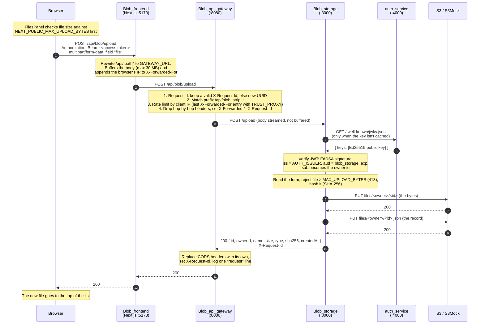
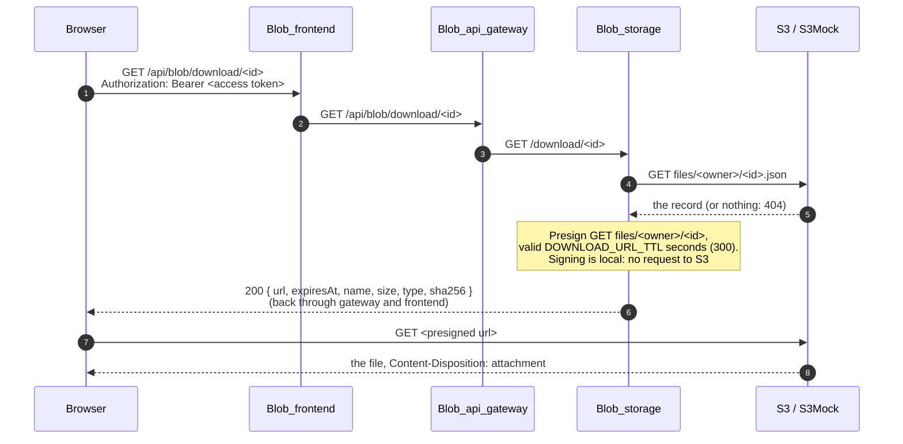

# Request flow

This page follows one upload from the browser to S3, hop by hop, then shows the body size limit at each hop. Downloads are at the end.

## Why the browser only talks to its own origin

The browser never calls the gateway or a service directly. It calls `/api/...` on the address it loaded the app from, and Blob_frontend's Next.js server forwards the call to the gateway with a rewrite (`next.config.ts`):

```ts
{ source: "/api/:path*", destination: `${gatewayUrl}/api/:path*` }
```

This gives two things:

- **No CORS.** Every call is same-origin, whether you open the app at `localhost`, `127.0.0.1` or a network IP.
- **A first-party refresh cookie.** auth_service's `refresh_token` cookie is `SameSite=Strict`. It comes back through the gateway and Next.js, so the browser stores it for the app's own host and sends it on every `/api/*` call.

The gateway and services still send CORS headers, but they only matter for tools that call `:8080`, `:4000` or `:3000` directly. The full reasoning is in [ADR 0001](../decisions/0001-same-origin-api-proxy.md).

## An upload, hop by hop



What each hop is responsible for:

| Hop | Does | Doesn't |
| --- | --- | --- |
| Browser (`lib/api.ts`) | Adds `Authorization: Bearer` from memory, sends cookies (`credentials: "include"`). On `401`, refreshes once and retries. | Know where the gateway or services run. |
| Blob_frontend server | Forwards `/api/*` to `GATEWAY_URL`, adds the browser's address to `X-Forwarded-For`. | Look at tokens or bodies. |
| Blob_api_gateway | Routes by prefix (`/api/auth` → `AUTH_URL`, `/api/blob` → `BLOB_URL`), rate limits (`RATE_LIMIT`, default 300/min per IP), assigns the request id, logs. Returns `404`, `429` or `502` itself. | Check tokens. A request that skips the gateway is no less protected. |
| Blob_storage | Verifies the token, enforces the size limit, writes to S3, scopes everything to the token's user. | Trust any user id from the client. The owner always comes from the token's `sub`. |
| auth_service | Serves the public key. Blob_storage caches it, so auth_service isn't called on every request. | Take part in the upload otherwise. |

The gateway's routing and headers are in its [README](https://github.com/rades12340/Blob_api_gateway#what-it-does-with-a-request). Token checks are in [Authentication](auth-flow.md), and the S3 objects in [File storage](file-storage.md).

## Body size limits

Each hop has its own limit. Defaults:

| Hop | Limit | Set by | What happens over it |
| --- | --- | --- | --- |
| Browser | 25 MB (26,214,400 bytes) | `NEXT_PUBLIC_MAX_UPLOAD_BYTES` in Blob_frontend, baked in at build time | The app shows "That file is too large" and sends nothing. |
| Blob_frontend server | 30 MB | `experimental.proxyClientMaxBodySize: "30mb"` in `next.config.ts` | Next.js buffers proxied bodies and cuts them off at this size. Blob_storage then gets a truncated form and answers `400`. Next's own default is 10 MB, which is why this is raised. |
| Blob_api_gateway | 100 MB | `maxRequestBodySize` in `src/app.ts` (not configurable) | Bun refuses the body. Only there to keep huge bodies out; the body is streamed, not buffered. |
| Blob_storage, server | `MAX_UPLOAD_BYTES` + 1 MB (26 MB by default) | `maxRequestBodySize` in `src/app.ts`, room for the multipart envelope | Bun refuses the body before the route runs. |
| Blob_storage, route | 25 MB (26,214,400 bytes) | `MAX_UPLOAD_BYTES` | `413 { error: "File is larger than 26214400 bytes" }`, logged as `upload rejected` with `reason: "too large"`. |

"MB" here means MiB: 25 MB is 25 × 1024 × 1024 bytes.

To raise the upload limit, change all of these together:

1. `MAX_UPLOAD_BYTES` in Blob_storage (its server limit follows automatically).
2. `NEXT_PUBLIC_MAX_UPLOAD_BYTES` in Blob_frontend, then rebuild the image.
3. `proxyClientMaxBodySize` in Blob_frontend's `next.config.ts`, if the new limit is above about 29 MB.
4. The gateway's `maxRequestBodySize`, if the new limit is above about 99 MB.

Blob_storage reads the whole file into memory before writing it to S3, so very large limits cost RAM there.

If uploads fail or get cut off, see the [Upload rejected or cut off](../runbooks/upload-too-large.md) runbook.

## A download

Downloads don't stream file bytes through the system. Blob_storage only signs a link.



The browser sets `window.location.href` to the link. Because S3 answers with `Content-Disposition: attachment`, the browser saves the file and stays on the page.

## Errors along the way

| Status | Comes from | Means |
| --- | --- | --- |
| `401` | Blob_storage or auth_service | Missing, expired or invalid access token. The app refreshes once and retries. |
| `404 { error: "Not found" }` | Gateway | The path doesn't start with `/api/auth/` or `/api/blob/`. |
| `404` | Blob_storage | Unknown file id, or another user's file. |
| `413` | Blob_storage | File over `MAX_UPLOAD_BYTES`. |
| `429 { error: "Too many requests" }` | Gateway, or auth_service for `/register` and `/login` (20/min per IP) | Rate limit. |
| `500` on `/api/*` | Blob_frontend's server | It couldn't reach the gateway at `GATEWAY_URL`, for example because the gateway stack isn't running. |
| `502 { error: "Upstream unavailable" }` | Gateway | It couldn't reach auth_service or Blob_storage. See [Gateway returns 502](../runbooks/gateway-502.md). |
| `502 { error: "Storage unavailable" }` | Blob_storage | It couldn't reach S3. See [S3 unreachable](../runbooks/s3-unreachable.md). |

Every one of these responses carries `X-Request-Id`. Use it to find the request in the logs: see [Logging and request ids](logging.md).
