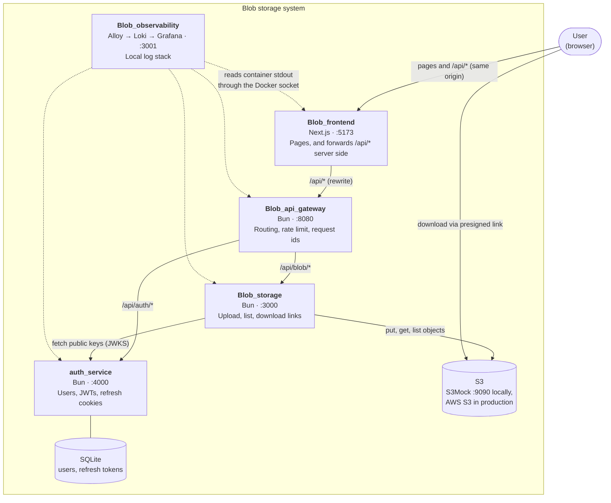

# Blob storage system

Blob is a small file storage system. A user signs up, signs in, uploads files, sees a list of their own files and downloads them again. Nobody else can see a user's files.

It is a set of Bun microservices, one per repo, plus a Next.js web app and a local log stack. This site covers what spans repos. Each repo's README covers how to run, test and change that repo.

New here? Start with [Getting started](getting-started.md).

## Containers

The main points:

- **The browser only talks to its own origin.** It loads pages from Blob_frontend and calls `/api/*` on the same address. The Next.js server forwards those calls to the gateway. There is no CORS, and auth_service's `SameSite=Strict` refresh cookie is first-party. See [Request flow](architecture/request-flow.md) and [ADR 0001](decisions/0001-same-origin-api-proxy.md).
- **The gateway only routes.** It picks the service by path prefix, rate limits and assigns a request id. It does not check tokens.
- **Each service checks tokens itself.** auth_service signs access tokens with an Ed25519 key. Blob_storage verifies them against auth_service's public keys (`/.well-known/jwks.json`). See [Authentication](architecture/auth-flow.md).
- **Downloads skip the services.** Blob_storage hands out a short-lived presigned S3 link and the browser fetches the file from S3 directly. See [File storage](architecture/file-storage.md).
- **Everything logs JSON to stdout**, with one request id across all hops. Blob_observability collects it locally. See [Logging and request ids](architecture/logging.md).

## Repo map

| Repo | Purpose | Port(s) | README |
| --- | --- | --- | --- |
| Blob_frontend | Next.js web app: sign up, sign in, upload, list, download. Forwards `/api/*` to the gateway. | 5173 | [README](https://github.com/rades12340/Blob_frontend#readme) |
| Blob_api_gateway | Single entry point for the API. Routes `/api/auth/*` and `/api/blob/*`, rate limits, request ids. | 8080 | [README](https://github.com/rades12340/Blob_api_gateway#readme) |
| auth_service | Sign-up, login, JWT access tokens, rotating refresh cookies, JWKS. Stores users in SQLite. | 4000 | [README](https://github.com/rades12340/auth_service#readme) |
| Blob_storage | Upload, list and download files in S3. Verifies access tokens. | 3000 (S3Mock: 9090) | [README](https://github.com/rades12340/Blob_storage#readme) |
| Blob_observability | Local log stack: Grafana Alloy, Loki and Grafana with a ready-made dashboard. | 3001 (Grafana), 3100 (Loki), 12345 (Alloy) | [README](https://github.com/rades12340/Blob_observability#readme) |

Loki and Alloy bind to `127.0.0.1` only. All other ports are published on every interface.

## Where to go next

| I want to | Read |
| --- | --- |
| Run the system on my machine | [Getting started](getting-started.md) |
| Call the API | [Using the API](api/index.md) |
| Understand why it is built this way | [Decisions](decisions/index.md) |
| Fix something that broke | [Runbooks](runbooks/index.md) |
| Look at logs and dashboards | [Observability](operations/observability.md) |
| Open a PR | [Contributing](contributing.md) |
