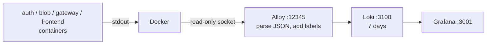

# Observability

[Blob_observability](https://github.com/rades12340/Blob_observability) is a local log stack: Grafana Alloy reads the services' container logs from Docker, Loki stores them, and Grafana shows them on a ready-made dashboard. The services don't change: they write one JSON line per event to stdout (see [Logging and request ids](../architecture/logging.md)). Why Loki: [ADR 0007](../decisions/0007-loki-instead-of-elk.md).



## Start it

The stack joins the shared `blob-storage` network, which auth_service's stack creates. Start it before or after the other stacks: Alloy picks containers up as they come and go.

```bash
git clone https://github.com/rades12340/Blob_observability
cd Blob_observability
docker network create blob-storage 2>/dev/null || true   # only if auth_service isn't up yet
docker compose up -d
```

| Address | What |
| --- | --- |
| <http://localhost:3001> | Grafana. The **Blob storage system** dashboard is the home page. |
| `http://127.0.0.1:3100` | Loki API, bound to this machine only. For scripts and LogCLI. |
| <http://127.0.0.1:12345> | Alloy's UI: the pipeline, and which containers it's reading. Open it when logs don't show up. |

!!! warning "Development only"
    Grafana has no login: everyone who can reach port 3001 is an admin. Don't run this stack on a shared or public machine. For production, see [below](#production).

Alloy only reads containers from the compose projects `auth-service`, `blob-service`, `api-gateway` and `blob-frontend`. If a service's logs are missing, check `docker compose ls` shows it under one of those names.

## Labels

| Label | Values |
| --- | --- |
| `project` | `auth-service`, `blob-service`, `api-gateway`, `blob-frontend` (the compose project) |
| `container` | `auth`, `blob`, `gateway`, `frontend` (the compose service) |
| `level` | `debug`, `info`, `warn`, `error`. Only on JSON lines, so the frontend's plain-text output has none. |

`requestId` is **structured metadata**, not a label: one label value per request would make Loki slow. You can still filter on it (`| requestId="…"`). Every other field (`message`, `status`, `ms`, `userId`, …) is inside the JSON line: add `| json` to use it.

Loki keeps logs for 7 days (`retention_period: 168h`).

## The dashboard

The **Blob storage system** dashboard has two variables at the top: **Service** (filters the time series and logs) and **Request id**. The four stat panels count events over the selected time range.

| Panel | What it counts | What to do when it's not what you expect |
| --- | --- | --- |
| **Gateway 502s** | Gateway `upstream request failed`: it couldn't connect to auth or blob. | Should be 0. A service or its stack is down, or not on the `blob-storage` network. Follow [Gateway returns 502](../runbooks/gateway-502.md). |
| **Failed logins** | auth `login failed` (wrong password or unknown email). | A few are normal. A spike from one `clientIp` is password guessing: the 20/min login limit slows it down. Check the lines' `clientIp` and `reason`. |
| **Refresh token reuse** | auth `refresh token reuse detected`. All that user's sessions were revoked. | Should be 0. Can mean a stolen cookie, or a client that refreshed twice in parallel. Follow [Refresh token reuse](../runbooks/refresh-token-reuse.md). |
| **Rate limited** | Gateway `rate limited` and auth `login rate limited`. | A burst from one IP is a script or an attack. Many IPs at once can mean `TRUST_PROXY` is wrong and everyone shares the proxy's address. Register rejections (`register rejected`, `reason: rate_limited`) aren't counted here: query them separately. |
| **Requests per second** | Access lines (`message="request"`) per service. | A drop to zero for one service while others carry on means it stopped logging or stopped getting traffic. |
| **Server errors (5xx) per second** | Access lines with `status >= 500`. | Gateway 502s show here as `gateway`. Blob 502s are S3 failures: see [S3 unreachable](../runbooks/s3-unreachable.md). Any 500 is a bug: find the `unhandled error` line. |
| **Latency p95** | 95th percentile of `ms` on the access lines. | Blob uploads read the whole file and write it to S3, so blob is the slowest. If one service jumps, check its warnings and S3 or auth reachability. |
| **Warnings and errors** | `warn` and `error` lines, per service and `message`. | Tells you *which* event is rising. Click through to the logs panel. |
| **Logs** | Raw lines for the selected services, filtered by **Request id** if set. | Use it to read the detail behind any panel. |

The dashboard is provisioned from `grafana/dashboards/blob-system.json`. Changes made in the UI are lost on restart: export the JSON (Share → Export) into that file and open a PR.

## Following one request

Every response carries `X-Request-Id`. The gateway generates it (or keeps a valid one the client sent) and passes it to the service, so the same id is on the gateway's line and the service's lines.

1. Get the id: in the browser, DevTools → Network → the request → Response headers. With curl, `curl -si … | grep -i x-request-id`, or send your own with `-H 'X-Request-Id: my-test-1'`.
2. Paste it into **Request id** at the top of the dashboard.
3. The **Logs** panel shows the gateway's `request` line and every line the service wrote for it, such as `auth failed` with its `reason`, or `storage request failed` with the S3 error.

In Explore, or without the dashboard:

```bash
curl -sG 127.0.0.1:3100/loki/api/v1/query_range \
  --data-urlencode 'query={project=~".+"} | requestId="my-test-1"' | jq -r '.data.result[].values[][1]'
```

## LogQL recipes

Open **Explore** in Grafana and pick the Loki data source. Use `container=~"auth|blob|gateway"` when you add `| json`, so the frontend's plain-text lines don't produce parse errors.

```logql
# Everything for one request, across services
{project=~".+"} | requestId="3f2c…"

# Errors in blob, with fields parsed
{container="blob", level="error"} | json

# Why blob turned tokens away, per reason
sum by (reason) (count_over_time({container="blob"} | json | message="auth failed" [1h]))

# Which upstream the gateway couldn't reach
sum by (upstream) (count_over_time({container="gateway"} | json | message="upstream request failed" [1h]))

# S3 failures by operation (put, get, list)
sum by (operation) (count_over_time({container="blob"} | json | message="storage request failed" [1h]))

# Slow requests, over 500 ms
{container=~"auth|blob|gateway"} | json | message="request" | ms > 500

# Failed logins per minute, and the IPs behind them
sum(count_over_time({container="auth"} | json | message="login failed" [1m]))
topk(5, sum by (clientIp) (count_over_time({container="auth"} | json | message="login failed" [15m])))

# Uploads rejected, per reason (too large, missing file, bad form)
sum by (reason) (count_over_time({container="blob"} | json | message="upload rejected" [1h]))

# Everything one user did (userId is on the access lines and most events)
{container=~"auth|blob"} | json | userId="191a6044-…"

# Share of gateway responses that were 5xx over 5 minutes
sum(count_over_time({container="gateway"} | json | message="request" | status >= 500 [5m]))
/
sum(count_over_time({container="gateway"} | json | message="request" [5m]))
```

`debug` lines (`token refreshed`, `files listed`) only exist when a service runs with `LOG_LEVEL=debug`. The compose files set `info`.

## What to alert on

Nothing is wired up to alert yet. These are the rules worth adding, in Grafana alerting locally or in the production backend:

| Alert | Threshold | Why |
| --- | --- | --- |
| Gateway can't reach a service | any, over 5 min | Users get 502s. [Runbook](../runbooks/gateway-502.md). |
| Server errors | 5xx share above 2% for 5 min | Something is failing more than occasionally. |
| Slow responses | gateway p95 above 1000 ms for 10 min | Users notice. |
| Failed-login spike | well above your normal rate, e.g. more than 50 in 5 min | Password guessing. |
| Refresh token reuse | any | Possible token theft. [Runbook](../runbooks/refresh-token-reuse.md). |
| S3 failing | any | Uploads and downloads fail. [Runbook](../runbooks/s3-unreachable.md). |
| Public key fetch failing | any | Blob can't check tokens, so every blob request gets 401. |

The queries, in the same order:

```logql
sum(count_over_time({container="gateway"} | json | message="upstream request failed" [5m]))

sum(count_over_time({container="gateway"} | json | message="request" | status >= 500 [5m]))
/
sum(count_over_time({container="gateway"} | json | message="request" [5m]))

quantile_over_time(0.95, {container="gateway"} | json | message="request" | unwrap ms [5m]) by (container)

sum(count_over_time({container="auth"} | json | message="login failed" [5m]))

sum(count_over_time({container="auth"} | json | message="refresh token reuse detected" [5m]))

sum(count_over_time({container="blob"} | json | message="storage request failed" [5m]))

sum(count_over_time({container="blob"} | json | message="public key fetch failed" [5m]))
```

## Production

This stack is for development: one Loki process on local disk and no login. In production, keep the services exactly as they are (JSON lines on stdout) and send the logs to a managed backend.

### On AWS: CloudWatch Logs

Use the `awslogs` log driver, or on ECS the task definition's `awslogs` log configuration. In compose, replace the `json-file` block of each service:

```yaml
logging:
  driver: awslogs
  options:
    awslogs-region: eu-central-1
    awslogs-group: /blob/gateway
    awslogs-create-group: "true"
```

The host or task role needs `logs:CreateLogStream` and `logs:PutLogEvents` (plus `logs:CreateLogGroup` with `awslogs-create-group`). CloudWatch Logs Insights finds the JSON fields by itself:

```text
fields @timestamp, service, message, status, path, route
| filter requestId = "3f2c…"
| sort @timestamp asc
```

```text
filter message = "request" and status >= 500
| stats count(*) by service, bin(5m)
```

Set the log groups' retention (it defaults to never expire), and build the alerts above as metric filters with CloudWatch alarms.

### Elsewhere: Grafana Cloud

Point Alloy's `loki.write` at the Grafana Cloud Loki endpoint, with its credentials in environment variables rather than the config file. The labels stay the same, so the dashboard JSON imports unchanged and the LogQL above keeps working.
